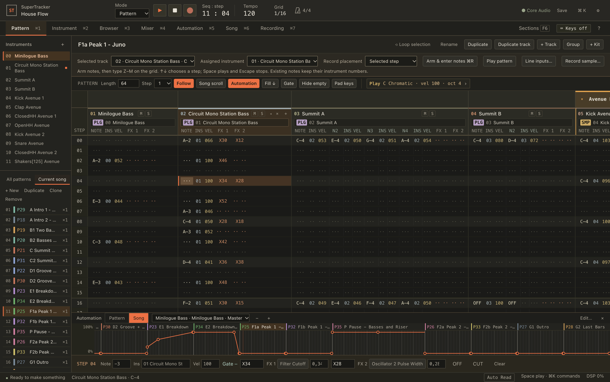
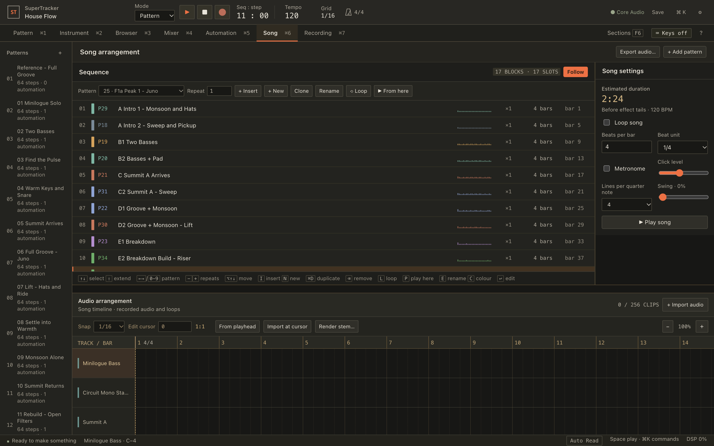
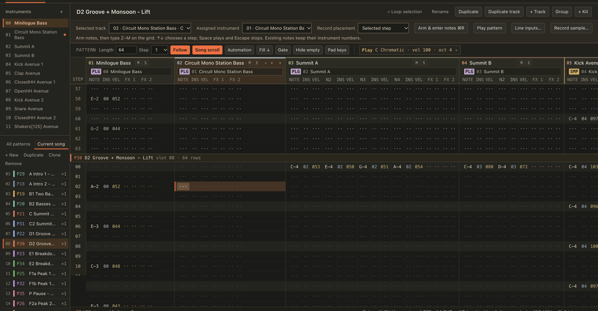

# SuperTracker

A keyboard-first music tracker and studio. Write patterns in a tracker grid, play chords and scales from the computer keyboard, and arrange, mix, automate and export the song in one app. It has its own audio engine and hosts Audio Unit, VST3 and CLAP plug-ins in separate processes, so a plug-in that crashes does not take the song down. The native side is written in Rust; the interface is a web page inside the app's window.



- **Tracker patterns** with step effects (probability, ratchet, glide, plug-in parameter locks) and pattern tools, all from the keyboard.
- **Play musically:** scales, chords and chord sets, note repeat and an arpeggiator, also from a MIDI keyboard.
- **Sounds:** a built-in synth, sampler and drum synths, 34 effects, kits, and browsers for samples, NKS presets and plug-ins.
- **Arrange, mix and automate:** song arranger, mixer with groups, sends and sidechains, and automation you can draw across patterns.
- **Every action has a key**, a `Cmd+K` command palette entry and a line in the keyboard reference (`?`).

| Song arranger | Song scroll: the grid runs through the song |
| --- | --- |
|  |  |

## Status

Version 0.2 is in development on a new Rust host that replaced the Swift application and the C++ engine of 0.1. What that means today:

- **Tested on Linux** (x86-64) without audio hardware: the engine, the mixer, plug-in containers with CLAP and VST3 test plug-ins, files, the library, and the interface in a browser against the real host.
- **Written for macOS but not yet run there.** The Mac window, Core Audio, CoreMIDI and Audio Unit hosting compile for Apple Silicon and have never been started on a Mac. [docs/PLUGIN_CONTAINER.md](docs/PLUGIN_CONTAINER.md) has the checklists for the first run.
- **Projects and kits saved by 0.1 or by earlier builds of 0.2 do not open.** There is one project format and no migration.
- Not tested with real audio interfaces, MIDI devices, a Maschine MK3 or third-party plug-ins.

[docs/HOST.md](docs/HOST.md) lists every host command with its state and what has been exercised; the [release notes](CHANGELOG.md) list what changed.

## Build

You need [Rust](https://rustup.rs) (stable). On macOS also Apple's command-line tools (`xcode-select --install`); on Linux the packages `libgtk-3-dev libwebkit2gtk-4.1-dev libasound2-dev pkg-config`.

```sh
git clone https://github.com/modulargraph/supertracker.git && cd supertracker
./scripts/build.sh            # macOS: build/SuperTracker.app    Linux: build/supertracker/
./scripts/run.sh              # debug build, run from the repository
./scripts/run.sh --serve      # no window: prints a local URL to open in a browser
./scripts/test.sh             # Rust tests, interface tests, browser test (details: docs/TESTING.md)
```

In the app, `Cmd+K` → **Load Midnight transmission demo** opens a demo song; `?` shows every key.

## Documentation

- [User guide](docs/USER_GUIDE.md): every workspace and its keys.
- [Feature status](docs/FEATURE_STATUS.md): what is built and how it was verified.
- [Architecture](docs/ARCHITECTURE.md), [the host and its commands](docs/HOST.md), [plug-in containers](docs/PLUGIN_CONTAINER.md), [audio engine](docs/AUDIO_ENGINE.md) and [testing](docs/TESTING.md) for contributors.

## License

GPL-3.0-or-later; see [LICENSE](LICENSE).
